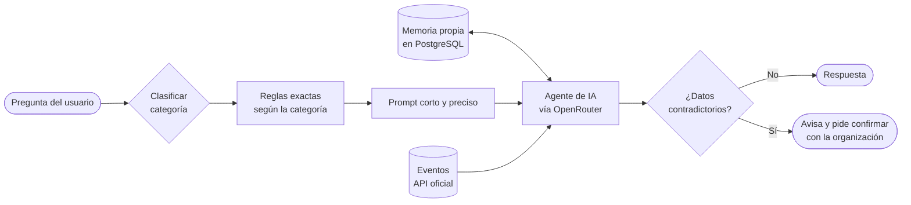

<a href="https://github.com/miguelugartedev">
  <picture>
    <source media="(prefers-color-scheme: dark)" srcset="https://readme-typing-svg.demolab.com?font=Poppins&weight=500&size=20&duration=3000&pause=1000&color=E6EDF3&center=true&vCenter=true&width=720&height=40&lines=Agentes+conversacionales+con+memoria+propia;Flujos+de+automatizaci%C3%B3n+con+n8n;Pruebo+y+mido+antes+de+entregar" />
    <source media="(prefers-color-scheme: light)" srcset="https://readme-typing-svg.demolab.com?font=Poppins&weight=500&size=20&duration=3000&pause=1000&color=12314A&center=true&vCenter=true&width=720&height=40&lines=Agentes+conversacionales+con+memoria+propia;Flujos+de+automatizaci%C3%B3n+con+n8n;Pruebo+y+mido+antes+de+entregar" />
    
  </picture>
</a>

 

---

## Perfil

> Construyo agentes conversacionales y flujos de automatización conectados a bases de datos y APIs. Me importa que lo que entrego funcione bien: **pruebo, mido y busco fallos antes de que lleguen al usuario.**

Estoy en mi cuarto año de Ingeniería en Computación en la Universidad Nacional de Ingeniería (UNI) y busco mi primera oportunidad profesional en desarrollo o automatización, ya sea en una empresa o como freelance.

---

## Proyecto destacado

### Agente de IA para consulta de eventos

Agente conversacional que responde consultas sobre los eventos de una comunidad. Lo desarrollé de punta a punta para un cliente en Costa Rica (trabajo remoto) y se entrega como un webhook listo para integrarse en sus canales.

#### Cómo piensa el agente

#### Qué resolví

| Tema | Detalle |
|---|---|
| **Latencia y tokens** | Clasifico cada pregunta por categoría y le paso al modelo solo las reglas que necesita, para que el prompt sea corto y preciso. |
| **Memoria propia** | Diseñé una tabla en PostgreSQL para la memoria de la conversación, porque el nodo por defecto de n8n se quedaba corto. |
| **Datos inconsistentes** | La API oficial a veces se contradice (un precio en un campo y otro distinto en la descripción). El agente lo detecta y le indica al usuario que confirme con la organización. |
| **Pruebas** | Unas 140 preguntas en 15 categorías, y pruebas de las respuestas de la API con Bruno. |
| **Revisión humana** | Prototipé una validación automática de respuestas, pero la revisión final la hago yo, porque es más confiable. |

<b>Ver las categorías de prueba</b>

 

- Básicas, intermedias y avanzadas
- Paráfrasis y jerga con errores de escritura
- Otros idiomas
- Fechas
- Datos del catálogo
- Conteo y filtros por precio
- Preguntas combinadas
- Preguntas de seguimiento (con memoria)
- Conversación libre
- Límites de seguridad
- Trampas y robustez

---

## Forma de trabajo

| 1 | 2 | 3 | 4 |
|:---:|:---:|:---:|:---:|
| **Entender** el problema real antes de automatizar | **Construir** la versión más simple que funcione | **Probar** con casos normales y con casos que intentan romperla | **Medir** latencia y consumo, y optimizar lo que sobra |

---

## Stack

**Desarrollo web**

**Integraciones**

---

## Explorando

Herramientas que conozco a nivel básico y sigo practicando.

---

## Actividad

  <picture>
    <source media="(prefers-color-scheme: dark)" srcset="https://raw.githubusercontent.com/miguelugartedev/miguelugartedev/output/github-snake-dark.svg" />
    <source media="(prefers-color-scheme: light)" srcset="https://raw.githubusercontent.com/miguelugartedev/miguelugartedev/output/github-snake.svg" />
    
  </picture>

---

## Contacto

Si tienes un proceso que se pueda automatizar o buscas a alguien para tu equipo, escríbeme.

